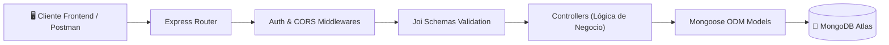

# ⚙️ Trackgenix Server - Backend API REST (Node.js & MongoDB)

[](https://nodejs.org/)
[](https://expressjs.com/)
[](https://www.mongodb.com/)
[](https://jestjs.io/)
[]()
[](https://www.postman.com/)
[]()
[]()

Backend API REST robusto y escalable desarrollado para la plataforma de gestión de recursos humanos y seguimiento de horas trabajadas **Trackgenix**, construida en equipo durante el bootcamp intensivo **Radium Rocket (Become a Software Professional - BaSP 2022)**.

Provee servicios backend completos para autenticación, gestión jerárquica de usuarios (Super Admins, Admins, Project Managers y Empleados), asignación de proyectos, catalogación de tareas y registro cronológico de partes de horas (*time-sheets*).

Frontend asociado: [trackgenix-app](https://github.com/gavafue/trackgenix-app).

---

## 👥 Equipo de Desarrollo & Colaboradores

Desarrollado de forma colaborativa simulando un entorno de ingeniería corporativo con metodologías ágiles (**Scrum**), integración continua y revisión de código:

### Equipo Core
| Desarrollador / Colaborador | Perfil GitHub | Responsabilidades Principales |
| :--- | :--- | :--- |
| **Gabriel Vázquez** | [@gavafue](https://github.com/gavafue) | Endpoints REST, esquemas de Mongoose, middlewares de autenticación y tests de integración |
| **Octavio Rodríguez Paseyro** | [@OctavioRodriguezPaseyro](https://github.com/OctavioRodriguezPaseyro) | Controladores, validaciones con Joi y lógica de negocio de recursos |
| **Paula Rinaldi** | [@paurinaldi](https://github.com/paurinaldi) | Modelado de datos, configuración de rutas y documentación técnica |
| **Marcia Berón** | [@MarciaBeron](https://github.com/MarciaBeron) | Endpoints de proyectos, empleados y contratos |
| **Pablo Nicolás Correa** | [@pcorreadev](https://github.com/pcorreadev) | Lógica de partes de horas (*time-sheets*) y catálogo de tareas |

### Colaboradores de Células de Backend & Cohorte
* **Alexis Ezequiel Suárez** ([@SuarezAlexisEzequiel](https://github.com/SuarezAlexisEzequiel))
* **Iara Criscenti** ([@iaracriscenti](https://github.com/iaracriscenti))
* **Marco Migliaro** ([@marcomigliaro](https://github.com/marcomigliaro))
* **Alejandro Santini** ([@AlejandroSantini](https://github.com/AlejandroSantini))
* **Nicolás Lalicata** ([@nicolaslalicata](https://github.com/nicolaslalicata))
* **Alan Acosta (DeepFreq)** ([@DeepFreq](https://github.com/DeepFreq))
* **Johsua Nowak** ([@Johsua30](https://github.com/Johsua30))
* **Shirley Seaton** ([@Shirley1702](https://github.com/Shirley1702))
* **Cristian (cristulian)** ([@cristulian](https://github.com/cristulian))

### 🎓 Tech Lead & Mentor
* **Samuel Trillo** ([@samueltrilloRR](https://github.com/samueltrilloRR)) - Tutor técnico, diseño de arquitectura y Code Reviewer (Radium Rocket).

---

## 🏗️ Arquitectura de la API



---

## 🎯 Entidades y Recursos de la API

| Recurso | Endpoints Principales | Descripción |
| :--- | :--- | :--- |
| **Super Admins** | `/api/super-admins` | Administración global del sistema y configuración de tenants |
| **Admins** | `/api/admins` | Gestión departamental, contrataciones y supervisión |
| **Employees** | `/api/employees` | Nómina de empleados, perfiles, tarifas horarias y datos personales |
| **Projects** | `/api/projects` | Creación de proyectos, asignación de PMs y vinculación de equipos |
| **Tasks** | `/api/tasks` | Catálogo de tipos de actividades laborales |
| **Time Sheets** | `/api/time-sheets` | Registro detallado de horas trabajadas por empleado, fecha y proyecto |

---

## 🛠️ Tecnologías y Herramientas

* **Runtime & Framework:** Node.js, Express.js.
* **Base de Datos & ODM:** MongoDB Atlas con Mongoose 6+.
* **Validación de Datos:** Joi schema validator.
* **Pruebas Automatizadas:** Jest con entorno Supertest para endpoints HTTP.
* **Documentación:** Colección oficial de Postman incluida (`postman_collection.json`).
* **Despliegue:** Preparado para Vercel Serverless / Cloud Hosting (`vercel.json`).

---

## 🚀 Instalación y Puesta en Marcha

```bash
# 1. Clonar el repositorio
git clone https://github.com/gavafue/trackgenix-server.git
cd trackgenix-server

# 2. Instalar dependencias
npm install

# 3. Configurar variables de entorno
# Crear archivo .env en la raíz con:
# PORT=3000
# DATABASE_URL=mongodb+srv://<usuario>:<password>@cluster.mongodb.net/trackgenix

# 4. Iniciar en modo desarrollo
npm run dev

# 5. Ejecutar suite de pruebas unitarias
npm test
```

---

## 📄 Licencia

Distribuido bajo la licencia MIT.
