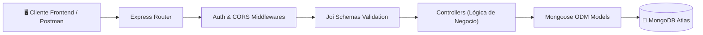

# ⚙️ Trackgenix Server - Backend API REST (Node.js & MongoDB)

[](https://nodejs.org/)
[](https://expressjs.com/)
[](https://www.mongodb.com/)
[](https://jestjs.io/)
[]()
[](https://www.postman.com/)
[]()

Backend API REST robusto y escalable desarrollado para la plataforma de gestión de recursos humanos y seguimiento de horas trabajadas **Trackgenix** (desarrollado en el bootcamp intensivo **Radium Rocket**).

Provee servicios backend completos para autenticación, gestión jerárquica de usuarios (Super Admins, Admins, Project Managers y Empleados), asignación de proyectos, catalogación de tareas y registro cronológico de partes de horas (*time-sheets*).

Frontend asociado: [trackgenix-app](https://github.com/gavafue/trackgenix-app).

---

## 🏗️ Arquitectura de la API



---

## 🎯 Entidades y Recursos de la API

| Recurso | Endpoints Principales | Descripción |
| :--- | :--- | :--- |
| **Super Admins** | `/api/super-admins` | Administración global del sistema y configuración de tenants |
| **Admins** | `/api/admins` | Gestión departamental, contrataciones y supervisión |
| **Employees** | `/api/employees` | Nómina de empleados, perfiles, tarifas horarias y datos personales |
| **Projects** | `/api/projects` | Creación de proyectos, asignación de PMs y vinculación de equipos |
| **Tasks** | `/api/tasks` | Catálogo de tipos de actividades laborales |
| **Time Sheets** | `/api/time-sheets` | Registro detallado de horas trabajadas por empleado, fecha y proyecto |

---

## 🛠️ Tecnologías y Herramientas

* **Runtime & Framework:** Node.js, Express.js.
* **Base de Datos & ODM:** MongoDB Atlas con Mongoose 6+.
* **Validación de Datos:** Joi schema validator.
* **Pruebas Automatizadas:** Jest con entorno Supertest para endpoints HTTP.
* **Documentación:** Colección oficial de Postman incluida (`postman_collection.json`).
* **Despliegue:** Preparado para Vercel Serverless / Cloud Hosting (`vercel.json`).

---

## 🚀 Instalación y Puesta en Marcha

```bash
# 1. Clonar el repositorio
git clone https://github.com/gavafue/trackgenix-server.git
cd trackgenix-server

# 2. Instalar dependencias
npm install

# 3. Configurar variables de entorno
# Crear archivo .env en la raíz con:
# PORT=3000
# DATABASE_URL=mongodb+srv://<usuario>:<password>@cluster.mongodb.net/trackgenix

# 4. Iniciar en modo desarrollo
npm run dev

# 5. Ejecutar suite de pruebas unitarias
npm test
```

---

## 👤 Autor

**Gabriel Vázquez**  
*Docente de Informática & Full Stack Developer*  
* [GitHub Profile](https://github.com/gavafue)  
* [LinkedIn](https://www.linkedin.com/in/gavafue/)
